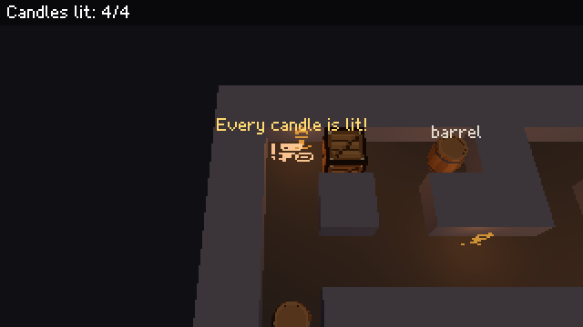
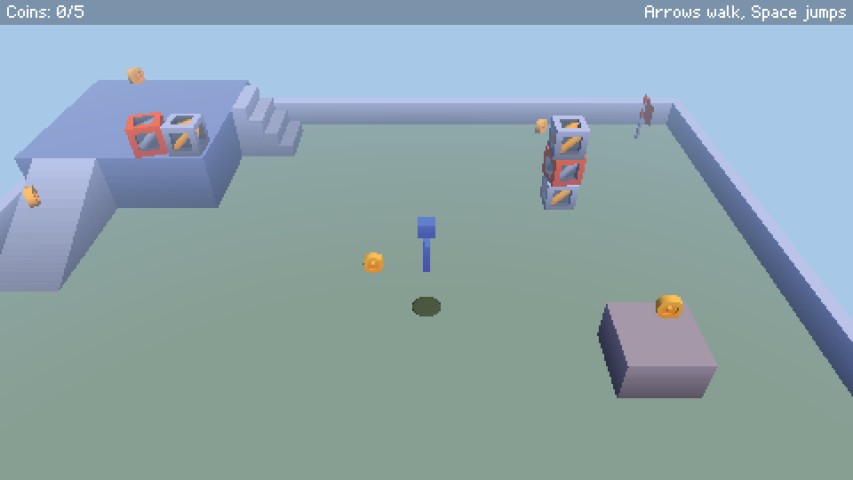
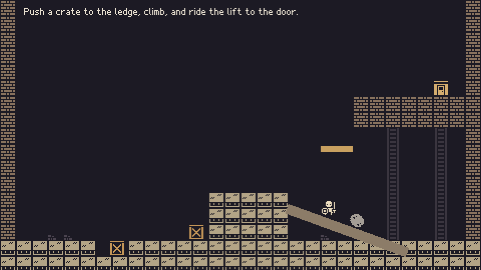
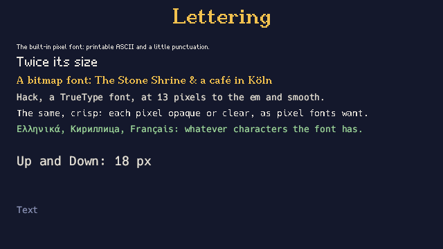
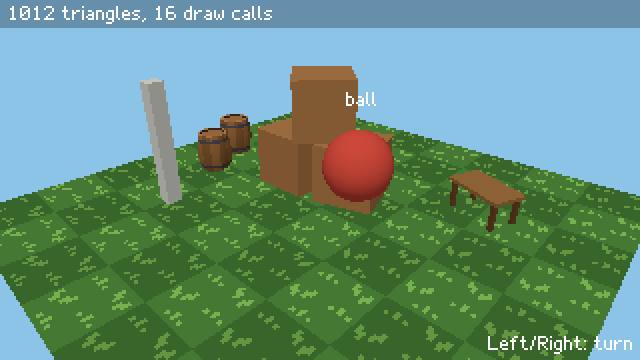
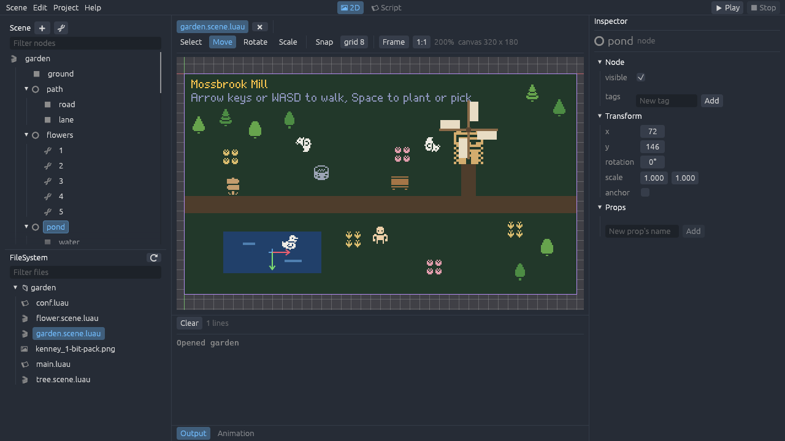

# Wingine

A 2D desktop game engine written in Rust. Games are written in Rust against the `wingine` crate,
or entirely in [Luau](https://luau.org) and run with the `wingine` executable.


Its examples include a tile-based [RPG](#rpg), a [bullet hell](#shmup) whose bullets run in Luau
or in a native library written in Rust, which [fits 3.4 times as many](#luau-and-rust-compared),
and games laid out in [scenes](docs/scenes.md). Scenes and scripts are edited in an
[editor](#editor) laid out like Godot's and built with Wingine itself.

## Features

- **Rendering** with [wgpu](https://wgpu.rs): sprites, sprite sheets, rectangles, lines and
  circles, batched by texture. A fixed resolution scales up by whole numbers for crisp pixel art,
  or to fit or fill the window, which can cover the screen.
- **Timing**: an update a frame, or at a fixed rate so games play the same at any frame rate.
  Frame stats and a headless benchmark show where the time goes.
- **3D views** among the 2D: lit meshes, glTF models and billboarded sprites, for 2.5D games,
  rendered at the canvas's resolution, and picked with the mouse.
- **Tilemaps** with layers, and a **camera** that follows the player.
- **Scenes**: trees of sprites, rectangles, text, areas, stacks, panels, tilemaps and 3D views, in
  files of plain Luau data that tools write as well as people. Screens anchor to the canvas,
  scenes place other scenes with overrides, and games find nodes by path or tag.
- **Menus** over scenes' nodes, moved through by the keys and the mouse.
- **Rigged characters** animated by clips of keyframes, layered and crossfaded.
- **Grid movement** from tile to tile, and **sprite animation**.
- **Physics** with [Rapier](https://rapier.rs), the same to the bit on every platform: solid
  scene nodes and tile maps, bodies that fall, roll and stack, lifts that carry what's on them,
  and characters that climb steps and slopes, pushing what they walk into, in 2D and 3D; and
  rays, overlaps and sensors in both.
- **Text** in a built-in pixel font, bitmap fonts and TrueType fonts, wrapped and revealed a
  glyph at a time.
- **Input** from the keyboard, mouse and gamepads, bound to named actions players can rebind.
- **Audio** with [kira](https://github.com/tesselode/kira): sound effects to change, pause and
  stop as they play, and music that crossfades.
- **Luau scripting** with [mlua](https://github.com/mlua-rs/mlua): sandboxed scripts with tasks
  that `wait` across frames. Whole games can be written in Luau, and replay the same inputs the
  same way on every platform.
- **Saves**, **headless runs** for tests and scripted screenshots, and **egui** interfaces over any
  game.
- **An editor** for scenes and scripts, laid out like Godot's.

Wingine targets Windows, macOS and Linux. CI builds and tests it on Windows and Linux.

## Getting started

You need a stable Rust toolchain and a C++ compiler (MSVC on Windows, `g++` or `clang`
elsewhere), since `mlua` builds Luau from source. On Linux, you also need the ALSA and udev
headers (`libasound2-dev` and `libudev-dev` on Debian and Ubuntu).

```bash
cargo run -- examples/rpg
```

Each tagged release also has the runtime (`wingine`) and the editor (`wingine-editor`) built for
Windows and Linux, on the [releases page](https://github.com/grindshell/wingine/releases). Run a
game with `wingine path/to/game`, or edit one with `wingine-editor path/to/game`. On Linux they
need ALSA's library (`libasound2`) and glibc 2.35 or newer.

## Examples

| Example | Written in | Run with |
|---|---|---|
| [RPG](#rpg) | Luau | `cargo run -- examples/rpg` |
| [Shmup](#shmup) | Luau | `cargo run --release -- examples/shmup` |
| [Pong](#pong) | Luau | `cargo run -- examples/pong` |
| [Garden](#garden) | Luau, around a scene file | `cargo run -- examples/garden` |
| [Orchard](#orchard) | Luau, around a rigged character | `cargo run -- examples/orchard` |
| [Cellar](#cellar) | Luau, in 2.5D | `cargo run -- examples/cellar` |
| [Course](#course) | Luau, in 3D with physics | `cargo run -- examples/course` |
| [Quarry](#quarry) | Luau, in 2D with physics | `cargo run -- examples/quarry` |
| [Lettering](#lettering) | Luau, around fonts | `cargo run -- examples/lettering` |
| [Sprites](#sprites) | Rust, with Luau scripts | `cargo run --example sprites` |
| [Shapes](#shapes) | Rust | `cargo run --example shapes` |
| [Meshes](#meshes) | Rust, in 3D | `cargo run --example meshes` |
| [egui](#egui) | Rust, with an egui panel | `cargo run --example gui` |

### RPG

[`examples/rpg`](examples/rpg) is a top-down RPG. The elder of Mossbrook asks you to check on the
shrine north of the village; what you find there sets creatures loose, to fight in turn-based
battles. Coins buy gear at the shop, and the game saves after every event.

| Talking to the elder | A creature on Shrine Hill notices you | A battle |
|---|---|---|
|  |  |  |

Walk with the arrow keys or WASD, talk and examine with Space, open your bag with Tab, and back out
with Escape; the title's Controls rebinds them. F1 shows a debug window laid out with egui from
Luau. Its maps are [scenes](docs/scenes.md) over Kenney's
[1-bit Pack](https://kenney.nl/assets/1-bit-pack), and its title is in a
[bitmap font](docs/api/graphics.md#font-files) drawn for it.

### Shmup

[`examples/shmup`](examples/shmup) is a bullet hell in the style of Touhou: waves of fairies, then
a boss with three spell cards.


Move with the arrow keys, hold Shift to focus, Z to shoot and X to bomb; Escape pauses. The title
also offers boss practice and a stress test.

Its enemy bullets go through one interface, implemented in Luau by
[`bullets.luau`](examples/shmup/bullets.luau) and in Rust by
[`danmaku`](examples/native-danmaku/src/lib.rs), a native library, and both fire the same bullets
to the bit. To run them in Rust, build the library, copy `target/release/danmaku.dll`
(`libdanmaku.so`, `libdanmaku.dylib`) into `examples/shmup/native/`, and press Tab in the game:

```bash
cargo build --release -p native-danmaku
```

#### Luau and Rust compared

The stress test pours out bullets until a frame takes longer than a 60th of a second:

| Bullets in | The most a 60th of a second fits | Each bullet's cost |
|---|---|---|
| Luau, `bullets.luau` | about 105,000 | 171 ns |
| Rust, `danmaku` | about 360,000 | 54 ns |


Measured in a release build on a Ryzen 7 5800X with an RTX 3080, counting the CPU's time to
update, draw and render. Drawing is where Luau loses most: each bullet it draws is a call into
the engine, while the library hands the engine all its bullets in a few calls. To measure it
yourself, put the library in place and run this script:

```text
tap Down
tap Down
tap Z
benchmark 40s
tap Tab
benchmark 40s
```

```bash
WINGINE_SCRIPT=stress.txt cargo run --release -- examples/shmup
```

### Pong

[`examples/pong`](examples/pong) is Pong against the computer, first to 5 points.


Move with W and S, the arrow keys, a gamepad or the mouse, and serve with Space or a click. F11
covers the screen. Nothing in it is random, so the same inputs play the same match on every
platform. Run with `--watch`, it keeps the match as it reloads. Its tests are in Luau:
`cargo run -- test examples/pong`.

### Garden

[`examples/garden`](examples/garden) is a garden around a windmill, laid out in a scene file,
[`garden.scene.luau`](examples/garden/garden.scene.luau), which a short script brings to life.


Walk with the arrow keys and stand beside things to read about them. Space throws a seed, which
grows where there's room, or picks a flower. The trees and flowers are instances with overrides,
and the solid things and notes are a physics world's colliders and sensors.

### Orchard

[`examples/orchard`](examples/orchard) is an orchard where a picker with a basket on their head
catches falling apples.


Walk with the arrow keys. The picker is a [rig](docs/scenes.md#rigging-characters) with clips for
standing, walking, blinking and reacting, which the game layers and crossfades.

### Cellar

[`examples/cellar`](examples/cellar) is a dark cellar in 2.5D, where the hero lights candles by
standing on them. Its level is a [3D view](docs/scenes.md#3d-views) of meshes and models made in
Blender, with billboarded sprites for the hero and candles.



Walk with the arrow keys, and point at a prop to name it.

### Course

[`examples/course`](examples/course) is a course to run around in 3D, collecting coins, built
from Kenney's [Prototype Kit](https://kenney.nl/assets/prototype-kit) and made solid by a
[physics world](docs/api/physics.md#in-3d).



Walk with the arrow keys or a stick, jump with Space, and zoom with the mouse wheel. The player
climbs the stairs, pushes crates over, and casts a shadow where a jump will land.

### Quarry

[`examples/quarry`](examples/quarry) is a level seen from the side, made physical by a
[2D physics world](docs/api/physics.md#bodies-and-characters-in-2d): a tile map solid where its
tiles are, crates that fall and stack, a boulder that rolls down a slope, and a lift that
carries what's on it.



Run with the arrow keys and jump with Space: push a crate against the ledge to climb it, and
ride the lift up to the door.

### Lettering

[`examples/lettering`](examples/lettering) is a type specimen: the built-in pixel font, the RPG
title's bitmap font, and [Hack](https://sourcefoundry.org/hack/), a TrueType font, smooth and
crisp. Its scene's text nodes name their [font files](docs/api/graphics.md#font-files).



Up and Down resize the sample line, and the paragraph reveals itself a glyph at a time.

### Sprites

[`examples/sprites.rs`](examples/sprites.rs) is a small map in Rust with its events in Luau
([`sprites.luau`](examples/sprites.luau)): a tilemap, a following camera, mouse input, music, and
a scripted bat and note.


### Shapes

[`examples/shapes.rs`](examples/shapes.rs) is the smallest example: each kind of shape, filled and
outlined.


### Meshes

[`examples/meshes.rs`](examples/meshes.rs) draws meshes and models in a 3D view at 320x180, lit
by the sun, with a HUD over it. Its models are in [`examples/models`](examples/models), made in
Blender ([`props.blend`](examples/models/props.blend)).



### egui

[`examples/gui.rs`](examples/gui.rs) bounces sprites around, tuned from an egui panel that shows a
map of them drawn by the engine. F3 shows the frame stats. Luau games lay out interfaces too: see
[`docs/api/gui.md`](docs/api/gui.md).

## Editor

[`crates/wingine-editor`](crates/wingine-editor) edits a game's scenes and scripts. It's a Wingine
game itself, laid out like Godot's editor: the scene tree and the game's files on the left, the
Inspector on the right, and the scene in the middle, drawn as the game draws it.



```bash
cargo run -p wingine-editor -- examples/garden
```

It selects, moves and changes nodes, paints tilemaps, places and overrides instances, lays out
screens, animates rigs on a timeline, edits 3D views, undoes, saves in the canonical layout, and
plays the game. Its Script screen checks Luau against the engine's API with
[luau-lsp](https://github.com/JohnnyMorganz/luau-lsp), if it's installed. See
[the editor's docs](docs/editor.md).

## Making a game

A Luau game is a folder with a `main.luau` script and, optionally, a `conf.luau` of settings. The
script's top level runs once; then each frame the engine calls its global `update(dt)` and
`draw()`.

```lua
-- conf.luau
return { title = "Hello", resolution = { width = 320, height = 180 } }
```

```lua
-- main.luau
local x = 152

input.bind("left", { "Left", "A" })
input.bind("right", { "Right", "D" })

function update(dt: number)
    if input.held("left") then
        x -= 80 * dt
    end
    if input.held("right") then
        x += 80 * dt
    end
end

function draw()
    graphics.clear("#1d232b")
    graphics.fill_rect(x, 82, 16, 16, "#e06c4a")
end
```

Run it with `cargo run -- path/to/folder`, or with `--watch` to reload it as its files change.
`cargo run -- test path/to/folder` runs its `*.test.luau` tests, and
`cargo run --release -- export path/to/folder dist/game` makes a folder to ship. Compiled code can
go in a [native library](docs/native-libraries.md) written in Rust. [The docs](docs/README.md)
cover the rest, with a reference to every function and type scripts use.

A Rust game implements the `Game` trait and passes it to `wingine::run`:

```rust
use wingine::{
    Context, Game, WindowConfig,
    graphics::{Canvas, Color},
    input::Key,
    math::Rect,
};

struct Hello {
    x: f32,
}

impl Game for Hello {
    fn update(&mut self, ctx: &mut Context, dt: f32) {
        if ctx.input().held("right") {
            self.x += 120.0 * dt;
        }
    }

    fn draw(&mut self, canvas: &mut Canvas) {
        canvas.clear(Color::rgb8(0x1d, 0x23, 0x2b));
        let square = Rect::new(self.x, 100.0, 32.0, 32.0);
        canvas.fill_rect(square, Color::rgb8(0xe0, 0x6c, 0x4a));
    }
}

fn main() -> wingine::Result<()> {
    wingine::run(WindowConfig::default(), |ctx| {
        ctx.input_mut().bind("right", [Key::Right, Key::D]);
        Ok(Hello { x: 0.0 })
    })
}
```

## Testing

`cargo test` plays the examples headlessly, with simulated input and checks on game state, and
compares rendering with the reference images in [`tests/screenshots/`](tests/screenshots)
(`UPDATE_SCREENSHOTS=1` updates them). To check a game without a window, point `WINGINE_SCRIPT` at
a [script](src/script.rs) of simulated input; the game follows it, saves screenshots beside it,
and exits:

```bash
WINGINE_SCRIPT=check.txt cargo run -- examples/rpg
```

## Credits

The tileset is Kenney's [1-bit Pack](https://kenney.nl/assets/1-bit-pack), and the course's models
Kenney's [Prototype Kit](https://kenney.nl/assets/prototype-kit), both CC0; the RPG's
`strides.png` adds walking frames derived from the tileset. [Hack](https://sourcefoundry.org/hack/)
is under the MIT and Bitstream Vera licenses, beside it in the lettering example. The rest of the
art, the models, the music and the sound effects were made for the examples.

## License

Wingine is licensed under either of

- the Apache License, Version 2.0 ([LICENSE-APACHE](LICENSE-APACHE)), or
- the MIT license ([LICENSE-MIT](LICENSE-MIT))

at your option.

Unless you explicitly state otherwise, any contribution intentionally submitted for inclusion in
Wingine by you, as defined in the Apache-2.0 license, shall be dual licensed as above, without any
additional terms or conditions.

The release binaries are built with crates under licenses of their own, listed with their texts in
each archive's `THIRD-PARTY-NOTICES.txt`. [cargo-about](https://github.com/EmbarkStudios/cargo-about)
writes it from [`about.toml`](about.toml) and [`about.hbs`](about.hbs):

```bash
cargo about generate --target x86_64-pc-windows-msvc -m crates/wingine-editor/Cargo.toml -c about.toml -o THIRD-PARTY-NOTICES.txt about.hbs
```
