# Wingine

A 2D desktop game engine written in Rust. Games are written in Rust against the `wingine` crate,
or entirely in [Luau](https://luau.org) and run with the `wingine` executable.

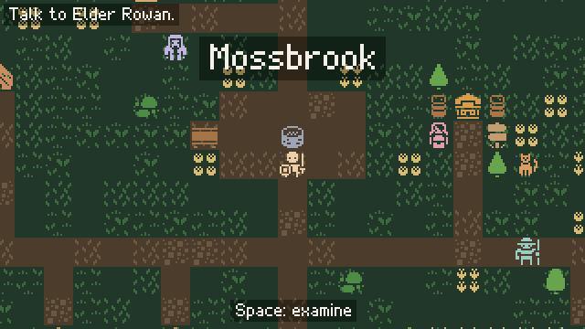

Its examples include a tile-based [RPG](#rpg), a [bullet hell](#shmup) whose bullets run in Luau
or in a native library written in Rust, which [fits 3.4 times as many](#luau-and-rust-compared),
and games laid out in [scenes](docs/scenes.md). Scenes and scripts are edited in an
[editor](#editor) laid out like Godot's and built with Wingine itself.

## Features

- **Rendering** with [wgpu](https://wgpu.rs): sprites, rotated or not, sprite sheets and solid
  shapes, batched by texture. A fixed resolution, such as 320x180, scales up by whole numbers for
  crisp pixel art.
- **Timing**: games update once a frame by the frame's time, or at a fixed rate, such as 60 times
  a second, so they play the same at any frame rate. Frame stats and a headless benchmark show
  where each frame's time goes.
- **Tilemaps** with layers and tilesets, culled to the view, and a **camera** that follows the
  player and stays inside the map.
- **Scenes**: trees of sprites, rectangles, text, areas and tilemaps laid out in files of plain
  Luau data, which tools can write as well as people. Nodes turn and stretch about pivots,
  carrying what's inside them along; screens anchor to the canvas's edges and middle, with text
  aligned left, center or right; scenes place other scenes, changed by overrides; and games find
  nodes by path or tag, test the mouse against them, and add and remove them as they play.
- **Rigged characters**: sprites for parts that turn about their joints, animated by clips of
  keyframes in scene files, which games layer and crossfade.
- **Grid movement** from tile to tile, with tile collision.
- **Sprite animation**, such as walk cycles.
- **Text** in a built-in pixel font, wrapped to a width and revealed a little at a time for
  dialogue.
- **Input** from the keyboard and mouse, with keys bound to named actions.
- **Audio** with [kira](https://github.com/tesselode/kira): sound effects, and music that loops
  and crossfades.
- **Luau scripting** with [mlua](https://github.com/mlua-rs/mlua): sandboxed scripts, with tasks
  that `wait` across frames for NPCs, dialogue and events. Whole games can be written in Luau.
- **Headless runs**: games run without a window for tests and for scripted runs that save
  screenshots.
- **egui** interfaces over any game, in Rust or Luau, for debug panels and tools, and a window of
  frame stats any game can show with a key. Tests click their widgets by name.
- **An editor** for scenes and scripts, laid out like Godot's: a tree of nodes, an Inspector, a
  viewport with gizmos, painting tilemaps, placing and overriding instances, laying out screens,
  animating rigs on a timeline, undo, playing the game, and a script editor that checks scripts
  against the engine's API with luau-lsp.

Wingine targets desktops: Windows, macOS and Linux. CI builds and tests it on Windows and Linux.

## Getting started

You need a stable Rust toolchain and a C++ compiler (MSVC on Windows, `g++` or `clang`
elsewhere), since `mlua` builds Luau from source. On Linux, audio also needs the ALSA headers
(`libasound2-dev` on Debian and Ubuntu).

Clone the repository and play the RPG:

```bash
cargo run -- examples/rpg
```

The first build takes a little longer while Luau compiles.

## Examples

| Example | Written in | Run with |
|---|---|---|
| [RPG](#rpg) | Luau | `cargo run -- examples/rpg` |
| [Shmup](#shmup) | Luau | `cargo run --release -- examples/shmup` |
| [Pong](#pong) | Luau | `cargo run -- examples/pong` |
| [Garden](#garden) | Luau, around a scene file | `cargo run -- examples/garden` |
| [Orchard](#orchard) | Luau, around a rigged character | `cargo run -- examples/orchard` |
| [Sprites](#sprites) | Rust, with Luau scripts | `cargo run --example sprites` |
| [Shapes](#shapes) | Rust | `cargo run --example shapes` |
| [egui](#egui) | Rust, with an egui panel | `cargo run --example gui` |

### RPG

[`examples/rpg`](examples/rpg) is a top-down RPG, written entirely in Luau. The elder of
Mossbrook asks you to check on the shrine on the hill north of the village. What you find there
sets creatures loose, and you fight them in turn-based battles. Coins from battles, and from
poking around, buy gear at the village shop.

| Talking to the elder | A creature on Shrine Hill notices you | A battle |
|---|---|---|
| 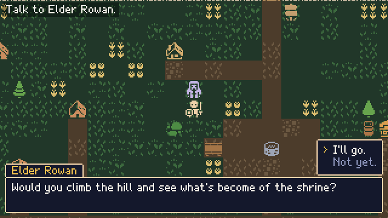 | 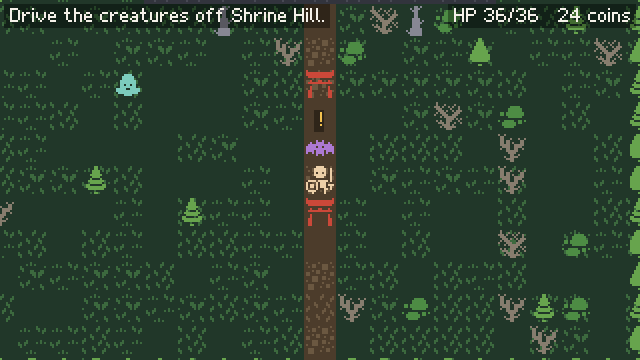 | 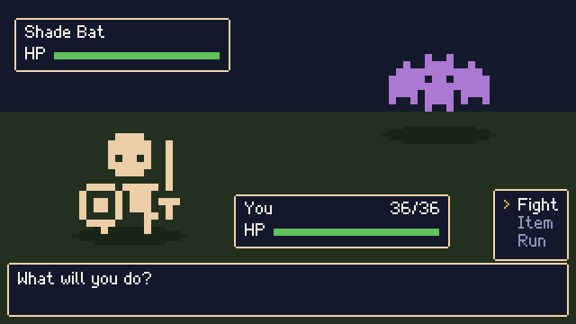 |

Walk with the arrow keys or WASD. Press Space, Enter or E to talk or to examine what's in front
of you, Tab or I to open your bag, and Escape or Backspace to back out of menus. F1 shows a debug
window, laid out with egui from Luau, to set your hit points, coins, items and quest, and jump
between maps.

The maps in [`maps/`](examples/rpg/maps) are [scenes](docs/scenes.md): tilemaps over the tiles of
[`world.tileset.luau`](examples/rpg/world.tileset.luau), with the places, exits, characters and
foes on them marked out as nodes. The story, battles, items and shop each have a script of their
own. The tileset is Kenney's [1-bit Pack](https://kenney.nl/assets/1-bit-pack).

### Shmup

[`examples/shmup`](examples/shmup) is a bullet hell in the style of Touhou, written entirely in
Luau: waves of fairies, then a boss with an opening attack and three spell cards. Shoot a spell
card down without being hit or bombing for its bonus.

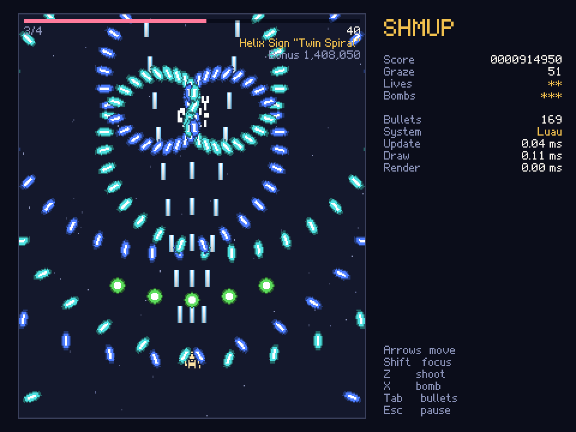

Move with the arrow keys or WASD, and hold Shift to move slowly and see your hitbox. Hold Z to
shoot and press X to bomb, which clears the bullets and keeps you safe for a moment. Grazing
bullets scores. Escape pauses. The title screen also offers boss practice and a stress test,
chosen with the keys or the mouse. The panel, title screen and messages are laid out in a
[scene](docs/scenes.md#laying-out-screens), [`hud.scene.luau`](examples/shmup/hud.scene.luau),
which the game fills in each frame.

The game is a benchmark too, and is best run as a release build. Its enemy bullets go through one
interface, implemented in Luau by [`bullets.luau`](examples/shmup/bullets.luau) and in Rust by
[`danmaku`](examples/native-danmaku/src/lib.rs), a native library the game loads if it's in its
`native` folder. Both do the same arithmetic, so from the same seed they fire the same bullets, to
the bit. To run bullets in Rust too, build the library:

```bash
cargo build --release -p native-danmaku
```

Then copy `target/release/danmaku.dll` (`libdanmaku.so` on Linux, `libdanmaku.dylib` on macOS)
into `examples/shmup/native/`, and press Tab in the game to switch between the two, which takes
the bullets over as they are. The stress
test pours out bullets until frames take longer than a 60th of a second, and plots frame time
against the bullet count for each.

#### Luau and Rust compared

Bullets in Rust fit about 3.4 times as many in a frame as bullets in Luau:

| Bullets in | The most a 60th of a second fits |
|---|---|
| Luau, `bullets.luau` | about 105,000 |
| Rust, `danmaku` | about 360,000 |

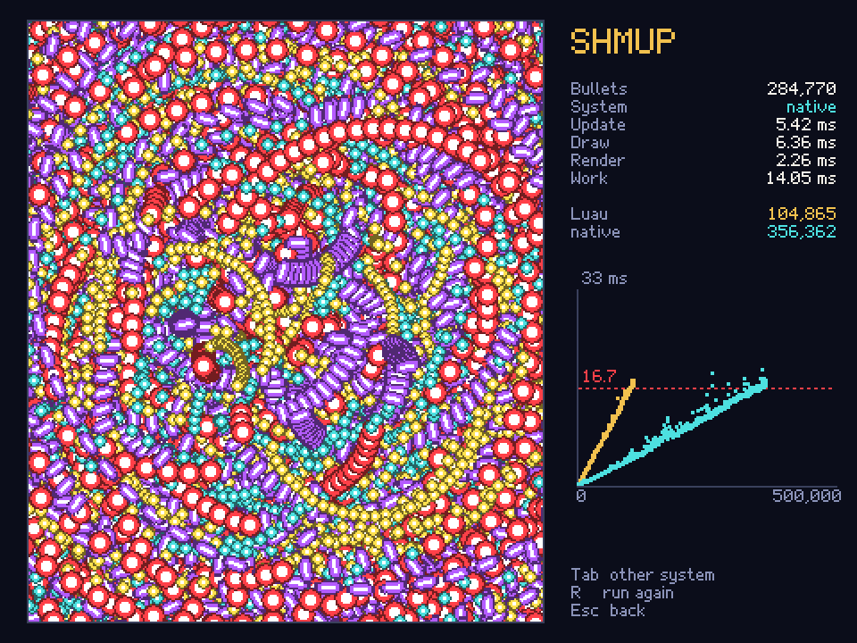

These are the stress test's limits in a release build, rendering every frame, on a Ryzen 7 5800X
with a GeForce RTX 3080 on Windows 10. Over three runs, Luau's limit ranged from 102,700 to
105,300 bullets and Rust's from 356,400 to 362,300. The limit is where the median of 30 frames
spends more than 16.7 ms updating, drawing and rendering. The GPU's own work isn't counted, since
in a window it runs while the next frame is prepared.

Each bullet costs this much of a frame:

| | Luau | Rust |
|---|---:|---:|
| Moving it | 53 ns | 16 ns |
| Checking it against the player | 9 ns | 4.5 ns |
| Drawing it: recording its quad | 99 ns | 23 ns |
| Rendering it: uploading its quad and submitting the draw | 8 ns | 8 ns |
| Waiting for the GPU | 2 ns | 3 ns |
| **Total** | **171 ns** | **54 ns** |

- **Drawing** is where Luau loses most. Each bullet it draws is a call from Luau into the engine,
  which costs about four times what recording the sprite does. The library hands the engine all
  its bullets in a few calls, so what's left is the engine recording quads.
- **Moving** a bullet needs its angle's cosine and sine. Both versions take them from the same C
  library, which keeps their bullets identical, and they take 9 of Rust's 16 ns. The rest of
  Luau's 53 ns is Luau's own overhead around the same arithmetic.
- **Checking** a bullet against the player is a few multiplications, so most of what it costs
  is reading the bullet from memory.
- **Rendering** isn't what limits either version: uploading quads and the GPU's work are a fifth
  of Rust's time.

To measure it yourself, put the library in place and run this script, which prints each limit:

```text
tap Down
tap Down
tap Z
benchmark 40s
tap Tab
benchmark 40s
```

```bash
WINGINE_SCRIPT=stress.txt cargo run --release -- examples/shmup
```

### Pong

[`examples/pong`](examples/pong) is Pong against the computer, written entirely in Luau. The
first to 5 points wins.

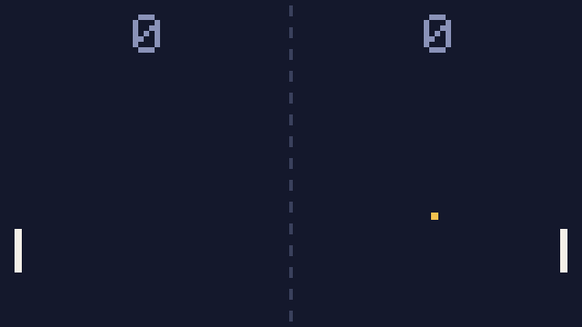

Move your paddle, on the left, with W and S, the arrow keys or the mouse. Press Space or click to
serve. Hits get faster and blip higher as a rally goes on, and sounds pan to where they happen.

### Garden

[`examples/garden`](examples/garden) is a garden around a windmill, laid out in a scene file,
[`garden.scene.luau`](examples/garden/garden.scene.luau), which the game's short script loads and
brings to life. The file is plain data, in the layout the engine writes scenes in, as a tool would
leave it.

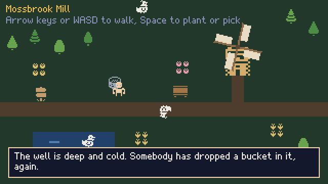

Walk with the arrow keys or WASD, and stand beside something to read about it. Press Space to
plant a flower, or to pick the one you're standing on. The mill's sails are a node holding four
arms and cloths, which turn together as the script turns the node; the birds circle the same way.
The trees and flowers are instances of scenes of their own, each changed by overrides, and
planting adds another. Things tagged `solid` are in the player's way, and areas tagged `note`
carry the text they show. See [Scenes](docs/scenes.md).

### Orchard

[`examples/orchard`](examples/orchard) is an orchard where apples ripen and fall, and a picker
with a basket on their head catches them. Three apples on the ground and the day is over.

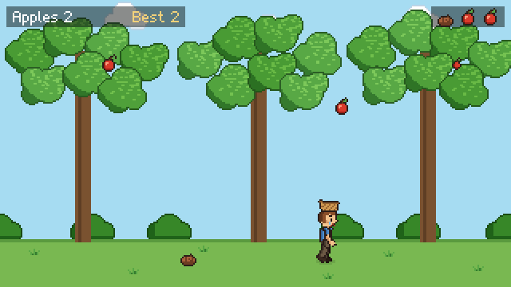

Walk with the arrow keys or A and D, and press Space to start again. The picker is a
[rig](docs/scenes.md#rigging-characters), in
[`picker.scene.luau`](examples/orchard/picker.scene.luau): a sprite for each part, turning about
its joint, and clips of keyframes for standing, walking,
blinking, catching, missing and giving up. Each frame the game poses the picker with one clip over
another, weighting the walk by how much they're walking, so they ease between standing and
walking, and fading the reactions in and out. The orchard places the picker as an instance of
that file, and their clips pose it there.

### Sprites

[`examples/sprites.rs`](examples/sprites.rs) is a small map written in Rust that uses Luau for
its events, in [`sprites.luau`](examples/sprites.luau). It shows a game built on the crate
directly: a tilemap, a camera that follows the hero, mouse input, music and sound, and a scripted
bat and note.

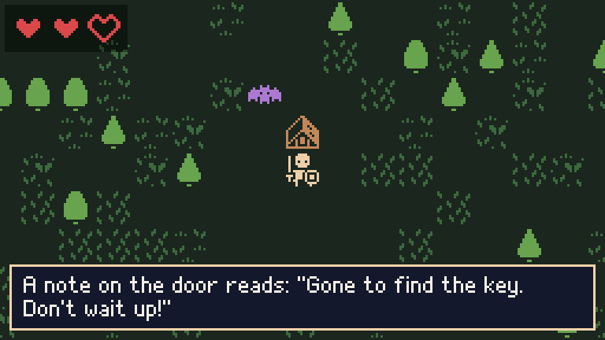

Walk with the arrow keys or WASD, or click a tile to walk toward it. Face the house and press
Space, Enter or E to read the note on its door.

### Shapes

[`examples/shapes.rs`](examples/shapes.rs) is the smallest example: a checkerboard, a sliding
square, and a translucent panel drawn over both.

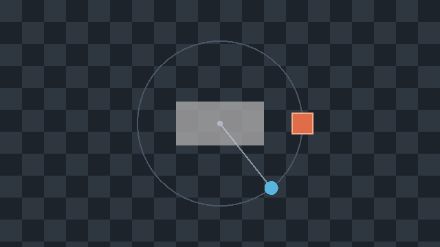

### egui

[`examples/gui.rs`](examples/gui.rs) bounces sprites around the window, tuned from an egui panel
that also shows a map of them, drawn by the engine into a texture. F3 shows the engine's window of
frame stats. Run it with `cargo run --example gui`. Luau games lay out interfaces too, in a
`gui(ui)` function of their own: see [`docs/api/gui.md`](docs/api/gui.md), and the RPG's F1
window.

## Editor

[`crates/wingine-editor`](crates/wingine-editor) edits a game's scenes and scripts. It's a Wingine
game itself, written in Rust, whose interface is egui, laid out like Godot's editor: the open
scene's tree of nodes over the game's files on the left, the Inspector on the right, Output along
the bottom, and the scene in the middle, drawn by the engine as the game draws it.


```bash
cargo run -p wingine-editor -- examples/garden
```

Select nodes in the tree or the viewport, change their fields in the Inspector, or move, turn and
stretch them with the mouse; add, rename, duplicate, move and delete them in the tree; paint
tilemaps' layers from their tilesets and resize them; drag scenes in to place them, and override
the nodes they place, from the Inspector; lay screens out with anchor presets and resize handles,
and preview them on canvases of other sizes; animate rigs, scrubbing and playing clips on a
timeline that poses the scene, and keying nodes' properties from the Inspector and the viewport;
undo; save, in the canonical layout; and play the game, in a process of its own. Its Script screen
edits the game's Luau, colored, and with [luau-lsp](https://github.com/JohnnyMorganz/luau-lsp)
installed, checks it against the engine's API as it's typed: problems underlined, names' types and
docs on hover, completion, and the parameters of calls. See [the editor's docs](docs/editor.md).

## Making a game

### In Luau

A Luau game is a folder with a `main.luau` script and, optionally, a `conf.luau` of settings.
The script's top level runs once to set the game up. Then each frame the engine calls its global
`update(dt)` and `draw()` functions.

```lua
-- conf.luau
return { title = "Hello", resolution = { width = 320, height = 180 } }
```

```lua
-- main.luau
local x = 152

input.bind("left", { "Left", "A" })
input.bind("right", { "Right", "D" })

function update(dt: number)
    if input.held("left") then
        x -= 80 * dt
    end
    if input.held("right") then
        x += 80 * dt
    end
end

function draw()
    graphics.clear("#1d232b")
    graphics.fill_rect(x, 82, 16, 16, "#e06c4a")
end
```

Run it with `cargo run -- path/to/folder`. The engine's API is the global tables `graphics`,
`input`, `audio`, `tilemap`, `grid` and `scene`. [The docs](docs/README.md) cover making a game in
Luau, from a quick start to native libraries, with a reference to every function and type scripts
use.

#### Native libraries

Code that needs to be compiled can live in a native library: a Rust `cdylib` written with the
[`wingine-native`](crates/wingine-native) crate, which adds a global table of functions and
classes to the game, and can hook in before and after each `update` and `draw`. A game lists the
libraries it loads in its `conf.luau`, and keeps them in its `native` folder:

```lua
-- conf.luau
return { libraries = { "particles" } } -- native/particles.dll, libparticles.so or .dylib
```

```lua
-- main.luau
local sparks = particles.new_emitter("#f2c14e")
sparks:burst(160, 90, 24)
```

A library listed as `{ name = "particles", optional = true }` loads only if it's there, so one
game can run with it or without it.

[`examples/native-particles`](examples/native-particles/src/lib.rs) is that library, and
[`examples/native-danmaku`](examples/native-danmaku/src/lib.rs) runs the shmup's bullets. Unlike
scripts, native libraries aren't sandboxed: a game that loads one runs it with the player's full
permissions.

### In Rust

A Rust game implements the `Game` trait and passes it to `wingine::run`:

```rust
use wingine::{
    Context, Game, WindowConfig,
    graphics::{Canvas, Color},
    input::Key,
    math::Rect,
};

struct Hello {
    x: f32,
}

impl Game for Hello {
    fn update(&mut self, ctx: &mut Context, dt: f32) {
        if ctx.input().held("right") {
            self.x += 120.0 * dt;
        }
    }

    fn draw(&mut self, canvas: &mut Canvas) {
        canvas.clear(Color::rgb8(0x1d, 0x23, 0x2b));
        let square = Rect::new(self.x, 100.0, 32.0, 32.0);
        canvas.fill_rect(square, Color::rgb8(0xe0, 0x6c, 0x4a));
    }
}

fn main() -> wingine::Result<()> {
    wingine::run(WindowConfig::default(), |ctx| {
        ctx.input_mut().bind("right", [Key::Right, Key::D]);
        Ok(Hello { x: 0.0 })
    })
}
```

## Testing

```bash
cargo test
```

The tests play the examples headlessly, with simulated input and checks on game state. Rendering
is covered by screenshot tests, which compare frames with the reference images in
[`tests/screenshots/`](tests/screenshots). Set `UPDATE_SCREENSHOTS=1` to create or update them.

To check a game without opening a window, point `WINGINE_SCRIPT` at a script of simulated input.
The game follows the script, saves screenshots next to it, and exits:

```text
hold Right 0.5s
tap Space
wait 1s
screenshot shots/after.png
```

```bash
WINGINE_SCRIPT=check.txt cargo run -- examples/rpg
```

The script format is documented in [`src/script.rs`](src/script.rs).

## Credits

The tileset is Kenney's [1-bit Pack](https://kenney.nl/assets/1-bit-pack), released under CC0.
The RPG's `strides.png` adds walking frames derived from it. The shmup's bullets and the
orchard's picker, apples and trees were drawn for them. The music and sound effects were
synthesized for the examples.
