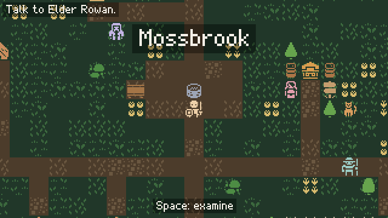
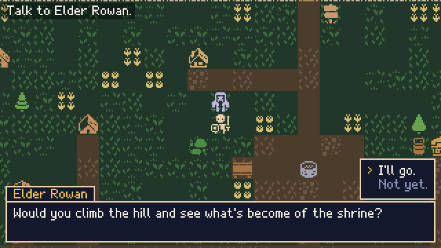
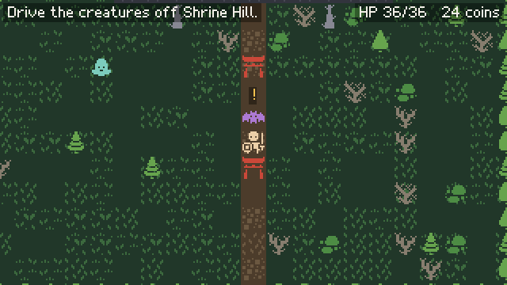
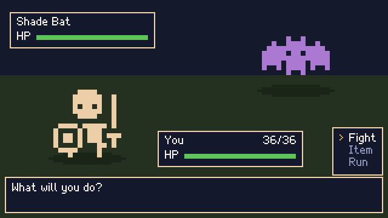
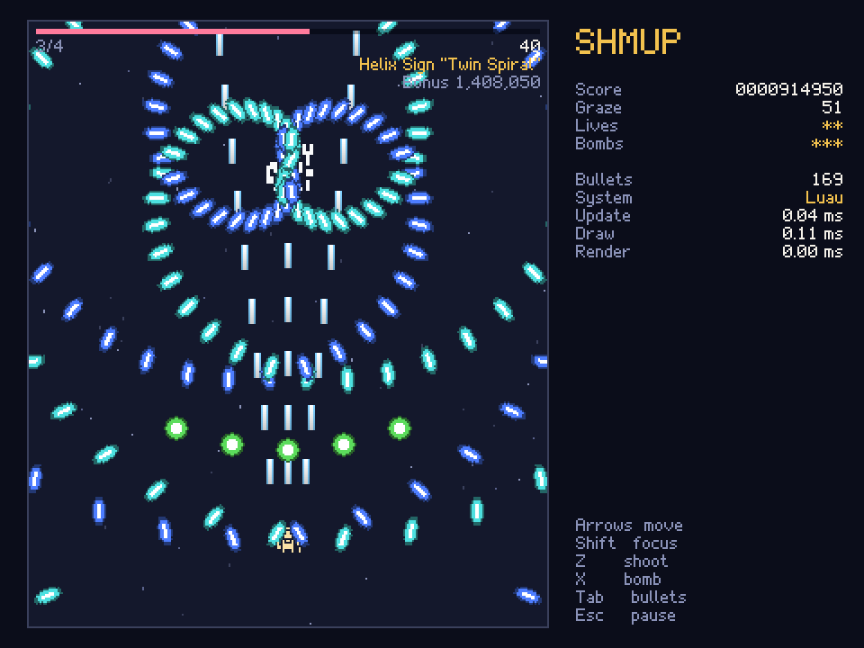
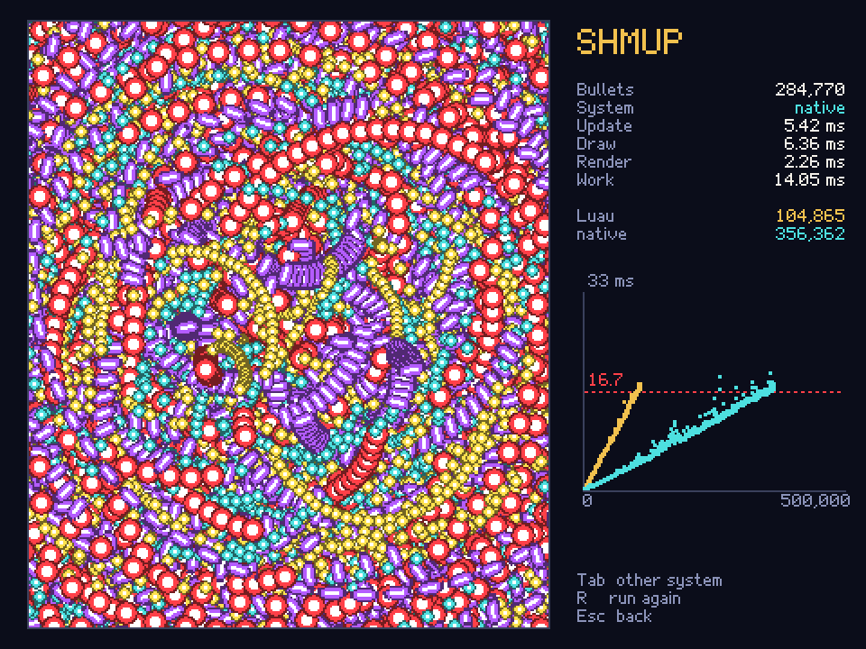
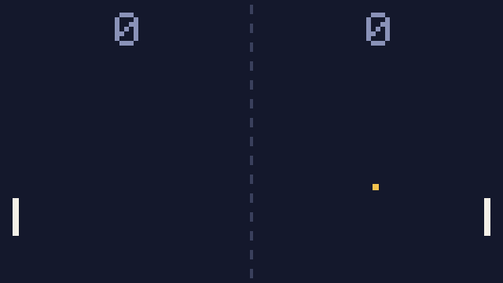
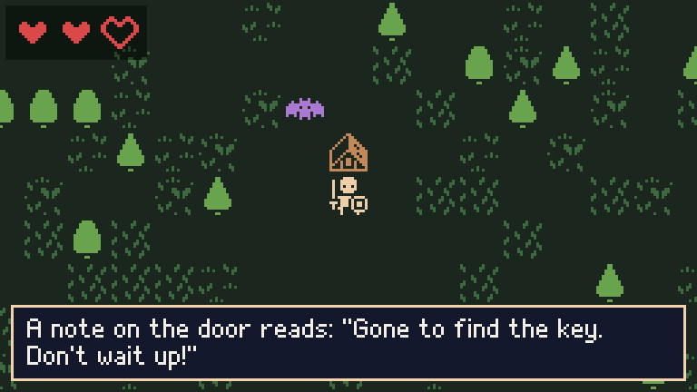
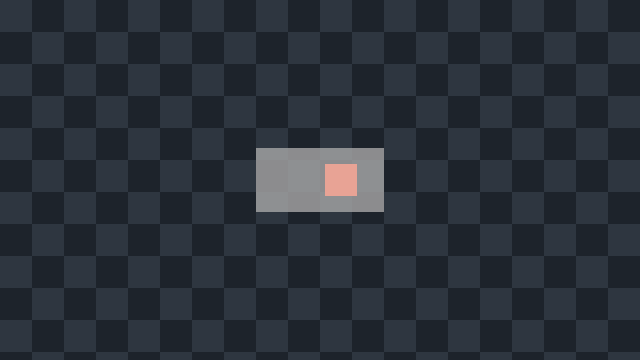

# Wingine

A 2D desktop game engine written in Rust. Games are written in Rust against the `wingine` crate,
or entirely in [Luau](https://luau.org) and run with the `wingine` executable.



Wingine's first milestone, everything needed to ship a tile-based, top-down RPG, is complete.
The [RPG example](#rpg) is that game. Its second, a bullet hell that shows the engine's
performance, is complete too: the [shmup](#shmup), whose bullets run in Luau or in a native
library written in Rust, which [fits 3.4 times as many](#luau-and-rust-compared).

## Features

- **Rendering** with [wgpu](https://wgpu.rs): sprites, rotated or not, sprite sheets and solid
  shapes, batched by texture. A fixed resolution, such as 320x180, scales up by whole numbers for
  crisp pixel art.
- **Timing**: games update once a frame by the frame's time, or at a fixed rate, such as 60 times
  a second, so they play the same at any frame rate. Frame stats and a headless benchmark show
  where each frame's time goes.
- **Tilemaps** with layers and tilesets, culled to the view, and a **camera** that follows the
  player and stays inside the map.
- **Grid movement** from tile to tile, with tile collision.
- **Sprite animation**, such as walk cycles.
- **Text** in a built-in pixel font, wrapped to a width and revealed a little at a time for
  dialogue.
- **Input** from the keyboard and mouse, with keys bound to named actions.
- **Audio** with [kira](https://github.com/tesselode/kira): sound effects, and music that loops
  and crossfades.
- **Luau scripting** with [mlua](https://github.com/mlua-rs/mlua): sandboxed scripts, with tasks
  that `wait` across frames for NPCs, dialogue and events. Whole games can be written in Luau.
- **Headless runs**: games run without a window for tests and for scripted runs that save
  screenshots.

Wingine targets desktops: Windows, macOS and Linux. CI builds and tests it on Windows and Linux.

## Getting started

You need a stable Rust toolchain and a C++ compiler (MSVC on Windows, `g++` or `clang`
elsewhere), since `mlua` builds Luau from source. On Linux, audio also needs the ALSA headers
(`libasound2-dev` on Debian and Ubuntu).

Clone the repository and play the RPG:

```bash
cargo run -- examples/rpg
```

The first build takes a little longer while Luau compiles.

## Examples

| Example | Written in | Run with |
|---|---|---|
| [RPG](#rpg) | Luau | `cargo run -- examples/rpg` |
| [Shmup](#shmup) | Luau | `cargo run --release -- examples/shmup` |
| [Pong](#pong) | Luau | `cargo run -- examples/pong` |
| [Sprites](#sprites) | Rust, with Luau scripts | `cargo run --example sprites` |
| [Shapes](#shapes) | Rust | `cargo run --example shapes` |

### RPG

[`examples/rpg`](examples/rpg) is the milestone's game, written entirely in Luau. The elder of
Mossbrook asks you to check on the shrine on the hill north of the village. What you find there
sets creatures loose, and you fight them in turn-based battles. Coins from battles, and from
poking around, buy gear at the village shop.

| Talking to the elder | A creature on Shrine Hill notices you | A battle |
|---|---|---|
|  |  |  |

Walk with the arrow keys or WASD. Press Space, Enter or E to talk or to examine what's in front
of you, Tab or I to open your bag, and Escape or Backspace to back out of menus.

The maps in [`maps/`](examples/rpg/maps) are rows of symbols, and the story, battles, items and
shop each have a script of their own. The tileset is Kenney's
[1-bit Pack](https://kenney.nl/assets/1-bit-pack).

### Shmup

[`examples/shmup`](examples/shmup) is a bullet hell in the style of Touhou, written entirely in
Luau: waves of fairies, then a boss with an opening attack and three spell cards. Shoot a spell
card down without being hit or bombing for its bonus.



Move with the arrow keys or WASD, and hold Shift to move slowly and see your hitbox. Hold Z to
shoot and press X to bomb, which clears the bullets and keeps you safe for a moment. Grazing
bullets scores. Escape pauses. The title screen also offers boss practice and a stress test.

The game is a benchmark too, and is best run as a release build. Its enemy bullets go through one
interface, implemented in Luau by [`bullets.luau`](examples/shmup/bullets.luau) and in Rust by
[`danmaku`](examples/native-danmaku/src/lib.rs), a native library the game loads if it's in its
`native` folder. Both do the same arithmetic, so from the same seed they fire the same bullets, to
the bit. To run bullets in Rust too, build the library:

```bash
cargo build --release -p native-danmaku
```

Then copy `target/release/danmaku.dll` (`libdanmaku.so` on Linux, `libdanmaku.dylib` on macOS)
into `examples/shmup/native/`, and press Tab in the game to switch between the two. The stress
test pours out bullets until frames take longer than a 60th of a second, and plots frame time
against the bullet count for each.

#### Luau and Rust compared

Bullets in Rust fit about 3.4 times as many in a frame as bullets in Luau:

| Bullets in | The most a 60th of a second fits |
|---|---|
| Luau, `bullets.luau` | about 105,000 |
| Rust, `danmaku` | about 360,000 |



These are the stress test's limits in a release build, rendering every frame, on a Ryzen 7 5800X
with a GeForce RTX 3080 on Windows 10. Over three runs, Luau's limit ranged from 102,700 to
105,300 bullets and Rust's from 356,400 to 362,300. The limit is where the median of 30 frames
spends more than 16.7 ms updating, drawing and rendering. The GPU's own work isn't counted, since
in a window it runs while the next frame is prepared.

Each bullet costs this much of a frame:

| | Luau | Rust |
|---|---:|---:|
| Moving it | 53 ns | 16 ns |
| Checking it against the player | 9 ns | 4.5 ns |
| Drawing it: recording its quad | 99 ns | 23 ns |
| Rendering it: uploading its quad and submitting the draw | 8 ns | 8 ns |
| Waiting for the GPU | 2 ns | 3 ns |
| **Total** | **171 ns** | **54 ns** |

- **Drawing** is where Luau loses most. Each bullet it draws is a call from Luau into the engine,
  which costs about four times what recording the sprite does. The library hands the engine all
  its bullets in a few calls, so what's left is the engine recording quads.
- **Moving** a bullet needs its angle's cosine and sine. Both versions take them from the same C
  library, which keeps their bullets identical, and they take 9 of Rust's 16 ns. The rest of
  Luau's 53 ns is Luau's own overhead around the same arithmetic.
- **Checking** a bullet against the player is a few multiplications, so most of what it costs
  is reading the bullet from memory.
- **Rendering** isn't what limits either version: uploading quads and the GPU's work are a fifth
  of Rust's time.

To measure it yourself, put the library in place and run this script, which prints each limit:

```text
tap Down
tap Down
tap Z
benchmark 40s
tap Tab
benchmark 40s
```

```bash
WINGINE_SCRIPT=stress.txt cargo run --release -- examples/shmup
```

### Pong

[`examples/pong`](examples/pong) is Pong against the computer, written entirely in Luau. The
first to 5 points wins.



Move your paddle, on the left, with W and S, the arrow keys or the mouse. Press Space or click to
serve. Hits get faster and blip higher as a rally goes on, and sounds pan to where they happen.

### Sprites

[`examples/sprites.rs`](examples/sprites.rs) is a small map written in Rust that uses Luau for
its events, in [`sprites.luau`](examples/sprites.luau). It shows a game built on the crate
directly: a tilemap, a camera that follows the hero, mouse input, music and sound, and a scripted
bat and note.



Walk with the arrow keys or WASD, or click a tile to walk toward it. Face the house and press
Space, Enter or E to read the note on its door.

### Shapes

[`examples/shapes.rs`](examples/shapes.rs) is the smallest example: a checkerboard, a sliding
square, and a translucent panel drawn over both.



## Making a game

### In Luau

A Luau game is a folder with a `main.luau` script and, optionally, a `conf.luau` of settings.
The script's top level runs once to set the game up. Then each frame the engine calls its global
`update(dt)` and `draw()` functions.

```lua
-- conf.luau
return { title = "Hello", resolution = { width = 320, height = 180 } }
```

```lua
-- main.luau
local x = 152

input.bind("left", { "Left", "A" })
input.bind("right", { "Right", "D" })

function update(dt: number)
    if input.held("left") then
        x -= 80 * dt
    end
    if input.held("right") then
        x += 80 * dt
    end
end

function draw()
    graphics.clear("#1d232b")
    graphics.fill_rect(x, 82, 16, 16, "#e06c4a")
end
```

Run it with `cargo run -- path/to/folder`. The engine's API is the global tables `graphics`,
`input`, `audio`, `tilemap` and `grid`. They are documented in
[`src/runtime/mod.rs`](src/runtime/mod.rs), and the types they hand out, such as sprites,
animations and tilemaps, in [`src/lua.rs`](src/lua.rs). Run `cargo doc --open` to browse the
same docs.

#### Native libraries

Code that needs to be compiled can live in a native library: a Rust `cdylib` written with the
[`wingine-native`](crates/wingine-native) crate, which adds a global table of functions and
classes to the game, and can hook in before and after each `update` and `draw`. A game lists the
libraries it loads in its `conf.luau`, and keeps them in its `native` folder:

```lua
-- conf.luau
return { libraries = { "particles" } } -- native/particles.dll, libparticles.so or .dylib
```

```lua
-- main.luau
local sparks = particles.new_emitter("#f2c14e")
sparks:burst(160, 90, 24)
```

A library listed as `{ name = "particles", optional = true }` loads only if it's there, so one
game can run with it or without it.

[`examples/native-particles`](examples/native-particles/src/lib.rs) is that library, and
[`examples/native-danmaku`](examples/native-danmaku/src/lib.rs) runs the shmup's bullets. Unlike
scripts, native libraries aren't sandboxed: a game that loads one runs it with the player's full
permissions.

### In Rust

A Rust game implements the `Game` trait and passes it to `wingine::run`:

```rust
use wingine::{
    Context, Game, WindowConfig,
    graphics::{Canvas, Color},
    input::Key,
    math::Rect,
};

struct Hello {
    x: f32,
}

impl Game for Hello {
    fn update(&mut self, ctx: &mut Context, dt: f32) {
        if ctx.input().held("right") {
            self.x += 120.0 * dt;
        }
    }

    fn draw(&mut self, canvas: &mut Canvas) {
        canvas.clear(Color::rgb8(0x1d, 0x23, 0x2b));
        let square = Rect::new(self.x, 100.0, 32.0, 32.0);
        canvas.fill_rect(square, Color::rgb8(0xe0, 0x6c, 0x4a));
    }
}

fn main() -> wingine::Result<()> {
    wingine::run(WindowConfig::default(), |ctx| {
        ctx.input_mut().bind("right", [Key::Right, Key::D]);
        Ok(Hello { x: 0.0 })
    })
}
```

## Testing

```bash
cargo test
```

The tests play the examples headlessly, with simulated input and checks on game state. Rendering
is covered by screenshot tests, which compare frames with the reference images in
[`tests/screenshots/`](tests/screenshots). Set `UPDATE_SCREENSHOTS=1` to create or update them.

To check a game without opening a window, point `WINGINE_SCRIPT` at a script of simulated input.
The game follows the script, saves screenshots next to it, and exits:

```text
hold Right 0.5s
tap Space
wait 1s
screenshot shots/after.png
```

```bash
WINGINE_SCRIPT=check.txt cargo run -- examples/rpg
```

The script format is documented in [`src/script.rs`](src/script.rs).

## Credits

The tileset is Kenney's [1-bit Pack](https://kenney.nl/assets/1-bit-pack), released under CC0.
The RPG's `strides.png` adds walking frames derived from it. The music and sound effects were
synthesized for the examples.
