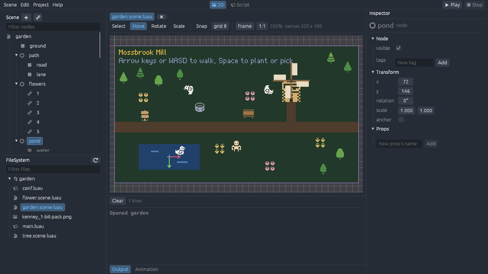

# The editor

The editor edits a game's [scenes](scenes.md): it shows them as the game draws them, and changes
their nodes with the mouse and the Inspector instead of by hand. It writes scene files back in
the canonical layout, so what it saves stays easy to read and diffs stay small. It edits the game's
scripts too, checking them against the engine's API as they're typed. It's laid out like
[Godot](https://godotengine.org)'s editor, and is itself a game made with Wingine, drawing its
interface with [egui](https://github.com/emilk/egui).



Run it from the repository with the game to edit:

```bash
cargo run -p wingine-editor -- examples/garden
```

Without a folder, it starts with a choice of the repository's examples, and **Project > Open
Folder…** opens any game.

The editor is new, and grows with each part of the current milestone. It edits scenes' nodes, the
scene's sheets and props, tilemaps' tiles, instances' overrides, screens' layouts, clips and
scripts now.

## The layout

- **The top bar**: the menus on the left; the main screens in the middle, the **2D** view of the
  open scene and the **Script** screen of the open scripts; and **Play** and **Stop** on the right.
- **The Scene dock**, at the top left: the open scene's tree of nodes.
- **The FileSystem dock**, below it: the files in the game's folder. Double-click a scene to open
  it, or drag it into the viewport or onto a node to place it there. Double-click any other Luau
  file to [edit it](#editing-scripts).
- **The Inspector**, on the right: every field of the selected node.
- **The bottom panel**: **Output**, with what the editor says and what a game played from it
  prints, **Tiles**, to [paint tilemaps](#painting-tiles) with, and **Animation**, to
  [animate rigs](#animating-rigs). Click a tab to show it, and click it again to hide the panel.
- **The middle**: in the 2D screen, a tab for each open scene, the viewport's toolbar, and the
  viewport; in the Script screen, the open scripts and the one being edited.

Drag the edges between them to resize them.

## The viewport

The viewport shows the open scene as the game draws it, laid out on the game's canvas: the size of
the [`resolution`](project-structure.md#resolution) in `conf.luau`, or of its window. A purple
rectangle outlines the canvas, and red and green lines are the scene's x and y axes through its
origin. A screen anchored to the canvas's edges is laid out as it is in the game, and can be
[previewed on canvases of other sizes](#laying-out-screens).

- **Pan** by dragging with the middle button, or with the left while holding Space.
- **Zoom** with the wheel, about the pointer. **Frame** shows the whole canvas again, and **1:1**
  shows a pixel of the scene for each of the screen's.
- **Select** a node by clicking it. What can be seen comes first, then areas, then plain nodes near
  their origins, then tilemaps. Click again in the same place for the node under that one, and so
  on, round to the first.

The selected node is outlined in blue, with a cross at its origin. Text and tilemaps move with
their node but don't turn or stretch, and their outline shows that.

## Changing nodes

The toolbar's tools, or their keys, decide what dragging in the viewport does:

| Tool | Key | Dragging |
|---|---|---|
| Select | Q | Selects the node under the pointer, and moves it; the selected node's handles resize it |
| Move | W | Moves the selected node, wherever the drag starts |
| Rotate | E | Turns the selected node about its origin |
| Scale | S | Stretches the selected node along its own axes; with Shift, evenly |

A node moves within its parent, so moving a node inside a turned parent changes its `x` and `y`
along the parent's axes. With **Snap** on, moving snaps `x` and `y` to the grid's spacing, turning
snaps to 15°, and stretching to tenths. Holding Shift snaps turning without it.

The **Inspector** shows the selected node's fields, as scene files name them:

- **Node**: whether it's `visible`, and its `tags`.
- **Transform**: `x` and `y`, `rotation` in degrees (scene files hold radians), `scale_x` and
  `scale_y`, and its `anchor`, if it has one. Drag a number to change it, or click it to type one.
- **Its kind's fields**: a sprite's sheet and cell (**Pick…** shows the sheet to click a cell
  in), its size, stretch, pivot and tint; a rect's size, stretch, pivot and color; text's text,
  scale, wrap, alignment, pivot and color; an area's size, stretch and pivot; a tilemap's tileset
  and size, which resizes its layers; an instance's scene, and the overrides it has, each of
  which selects the node it changes when clicked.
- **Props**: the node's data for the game. Add one by typing its name and choosing its kind of
  value; lists and tables hold more values.

Select the scene itself, at the top of the Scene dock, to change its sheets and props.

## Laying out screens

Screens, such as menus and HUDs, are laid out with [anchors](scenes.md): a node with an `anchor` is
placed from that point of its parent's rectangle, the canvas's for the nodes at the top of a scene,
so it stays in its corner or middle on a canvas of any size, and a node with a `stretch` grows and
shrinks with its parent.

- **Anchors**, in the toolbar, lays the selected node out in its parent by a preset, as Godot's do:
  into a corner, the middle of an edge or the middle, keeping its size, or stretched across its
  parent, along its top, middle or bottom, its left, middle or right, or all of it. The preset sets
  its `anchor`, a `pivot` at the same point of the node, and its size and `stretch`; `x` and `y`
  become the **margin** set below the presets, in from the parent's edges. Text lines up with the
  edge or middle it's put at, and only sprites, rects and areas stretch. **No Anchor** takes the
  anchor away, leaving the node where it is.
- With the **Select** tool, a selected sprite, rect or area has handles on its edges and corners:
  drag one to resize the node, its other edges staying where they are. A sprite takes a size of
  its own the first time.
- The canvas's size, in the toolbar, previews the scene laid out on canvases of other sizes:
  common ones, or any typed in, or drag the purple handle on the canvas's bottom-right corner. A
  preview changes nothing in the scene; **The game's** goes back to the game's own.

## The Scene dock

- **➕** adds a node of a kind inside the selected one, and **⛓** places another scene file in
  it, an instance. Right-click a node for the same, and more.
- **Rename** a node by double-clicking it or pressing F2, then typing a name and pressing Enter.
  Escape keeps the old name. Clips' tracks follow a node that's renamed or moved.
- **Duplicate** a node with Ctrl+D, and **delete** it with Delete.
- **Drag** a node onto another to move it inside it, onto the top edge of one to move it before it,
  or onto the bottom edge to move it after it. **Move Up** and **Move Down**, in its menu, change
  its place among its siblings: later nodes draw over earlier ones.

## Painting tiles

Select a tilemap's layer, in the Scene dock or with **Tiles** after selecting the tilemap, and the
**Tiles** panel shows the tiles of the map's tileset. Click one to paint with it; the viewport shows
it under the pointer, over a grid of the map's cells. Pressing in the viewport then paints the
layer, by the panel's tool:

| Tool | Pressing |
|---|---|
| Paint | Puts the tile in each cell dragged across |
| Rect | Fills the rectangle dragged out |
| Fill | Fills the cell clicked and the cells joined to it that hold the same tile |
| Pick | Chooses the tile in the cell clicked, then paints with it |

The right button empties cells instead, as **Erase** does with the left, and Control picks with any
tool. Each stroke is one change to undo. The editor keeps the layer's `legend` for you: a tile
painted for the first time gets a character, from its name where it can, and a character no cell
holds any more leaves it.

A selected tilemap, or a selected layer's, has handles on its right edge, its bottom edge and its
bottom-right corner: drag them to give it more or fewer columns and rows. Cells off the new edges
go, and new cells are empty.

## Instances and overrides

Drag a scene file from the FileSystem dock into the viewport to place it where it's dropped, as a
child of the selected node, or onto a node in the Scene dock to place it in that node. **⛓**, and
**Instance Child Scene** in a node's menu, place one too.

An instance in the Scene dock opens to show the nodes of the scene it places, in italics. Select
one to see it in the Inspector as the instance makes it, and change it there: the changes go into
the instance's `overrides`, as the scene file names them, and leave the scene it places alone.
Fields the overrides change are marked in blue, each with **⟲** to put it back as the scene has it,
and **Revert All** puts back every field. Changing a field back to the scene's value takes it out
of the overrides too.

## Animating rigs

A scene's [clips](scenes.md) animate its nodes, as a character's walk turns its limbs. The
**Animation** panel shows one at a time, chosen at its left; **New Clip** adds one a second long,
and **Rename Clip** and **Delete Clip** do what they say. Beside them are the clip's length, which
can't be shorter than its last key, and **Loop**, whether it starts over at its end.

While the panel shows, the clip poses the open scene in the viewport, as the game would at the
time its playhead is at, shown at the viewport's top right. Only the viewport is posed: the scene
file keeps its nodes as they were. Below the ruler of seconds, each of the clip's tracks is a row,
named for its node and property, with its keys along it: diamonds for numbers that move in a
straight line, squares for those that jump, and for visibility and cells.

- **Scrub** by clicking or dragging along the ruler or a row. **▶** plays the clip from the
  playhead, round and round if it loops, and **⏮** goes back to its start. With **Snap** on, the
  playhead and keys snap to the step beside it.
- **Click a key** to select it and move the playhead to it, and **drag** it to move it in time.
  Right-click it to delete it, or with the pointer over the panel, press Delete. Right-click a row
  to insert a key at that time, of the value the track has then.
- **Click a track's name** to select its node. A track whose node isn't in the scene is red.
  **linear** or **step** beside it switches how a number gets from key to key, and **🗑** removes
  the track.

Key nodes' properties from the Inspector. While the panel shows a clip, each property a clip can
change, `visible`, `x`, `y`, `rotation`, `scale` and a sprite's `cell`, has a **♦** beside it,
which puts a key of its value at the playhead, adding a track for it if the clip has none.
Properties the clip has tracks of are marked in yellow, and show as the clip poses them. Changing
one, in the Inspector or with the viewport's tools, keys it at the playhead: it changes the key
there, or adds one. Changing a property the clip has no track of changes the node itself, as it
does without a clip. The Inspector keys the scene's own nodes: to animate the nodes of a scene an
instance places, open that scene and give it clips of its own.

## Editing scripts

Double-click a script in the FileSystem dock to open it in the **Script** screen, which lists the
open scripts on its left and edits the one chosen. **File > New Script…** makes a script, at a path
in the game's folder, and opens it. Scripts are colored as Godot colors its own: keywords, names
of the engine's tables, functions called, strings, numbers and comments each in a color of their
own.

- **Enter** starts a line indented as the one before, and a level more after a line that opens a
  block, such as one ending in `then` or `do`.
- **Tab** indents by four spaces, or with lines selected, indents them all; **Shift+Tab** takes a
  level away.
- **Ctrl+Z** and **Ctrl+Y** undo and redo typing.
- **Ctrl+S** saves the script shown. Its name shows `*` while it has unsaved changes, and closing it
  or the editor asks first. A script changed on disk by another program is read again, unless it
  has changes of its own.

The status line under the script shows where the cursor is and how luau-lsp is doing.

### Checking scripts with luau-lsp

With [luau-lsp](https://github.com/JohnnyMorganz/luau-lsp), the Luau language server, installed
and on the `PATH` (or `WINGINE_LUAU_LSP` set to it), the editor checks scripts as they're typed,
against the engine's API:

- **Problems** are underlined, in red for errors and yellow for warnings, their line numbers are
  colored, and they're listed under the script; click one to go to it. **⛔ ⚠** in the status line
  shows and hides the list.
- **Resting the pointer** on a name shows what it is: its type, and for the engine's functions and
  types, their docs.
- **Typing** a name, or `.` or `:` after one, offers what could come next, narrowed as more is
  typed. **Up** and **Down** choose, **Enter** or **Tab** takes one, and **Escape** closes the list.
  **Ctrl+Space** offers them anywhere.
- **Typing `(`** in a call shows the function's parameters, the one the cursor is at underlined.

Without luau-lsp, scripts are edited all the same, unchecked, and Output says how to install it.
luau-lsp knows the engine from its definitions file,
[`src/runtime/wingine.d.luau`](../src/runtime/wingine.d.luau), which declares every table,
function and type scripts use, with their docs; the editor hands it to luau-lsp itself.

A game whose modules share a global table, as the RPG's do with `rpg`, names it in a `.luaurc` in
its folder, so luau-lsp knows it, and lets `main.luau` set it:

```json
{
    "globals": ["rpg"],
    "lint": { "BuiltinGlobalWrite": false }
}
```

### Other editors

luau-lsp checks scripts the same way in other editors, such as VS Code with its
[Luau Language Server](https://marketplace.visualstudio.com/items?itemName=JohnnyMorganz.luau-lsp)
extension, given the engine's definitions file. In VS Code's settings for the game's folder,
`.vscode/settings.json`:

```json
{
    "luau-lsp.platform.type": "standard",
    "luau-lsp.sourcemap.enabled": false,
    "luau-lsp.types.definitionFiles": { "@wingine": "path/to/wingine/src/runtime/wingine.d.luau" }
}
```

The engine calls a game's `update` and `draw`, so luau-lsp would warn they're never used; the
editor turns that warning off, and a `.luaurc` can too, with `"FunctionUnused": false` in its
`lint`.

## Saving, undo and playing

- **Ctrl+Z** undoes a change and **Ctrl+Y** (or Ctrl+Shift+Z) redoes it. A drag, or typing in a
  field, is one change.
- **Ctrl+S** saves the open scene, or in the Script screen, the script shown. A tab shows `*` while
  its scene has unsaved changes, and closing it or the editor asks first.
- **F5**, or **Play**, saves every scene and script and plays the game in a window of its own, as
  `cargo run -- path/to/game` would. What it prints shows in Output. **F8**, or **Stop**, ends it.

The editor writes scene files in the canonical layout, as
[`SceneFile::to_luau`](scenes.md) does. A file already in it changes only where the scene did, but
the layout has no comments: saving a scene written by hand drops its comments.

The editor reads the game's folder again every few seconds, so files changed elsewhere, such as
images, show up without opening them again.

## Shortcuts

| Keys | |
|---|---|
| Ctrl+S | Save the open scene, or the script shown |
| Ctrl+Z, Ctrl+Y | Undo, redo |
| Ctrl+Space | Offer what could be typed, in a script |
| Tab, Shift+Tab | Indent and unindent lines, in a script |
| Ctrl+D | Duplicate the selected node |
| Delete | Delete the selected node, or over the timeline, the selected key |
| Escape | Select nothing |
| F2 | Rename the selected node |
| Q, W, E, S | The Select, Move, Rotate and Scale tools |
| F5, F8 | Play, stop |
| Right button, Ctrl+click | Erase, pick, while painting tiles |
| Middle drag, Space+drag | Pan the viewport |
| Wheel | Zoom the viewport |
